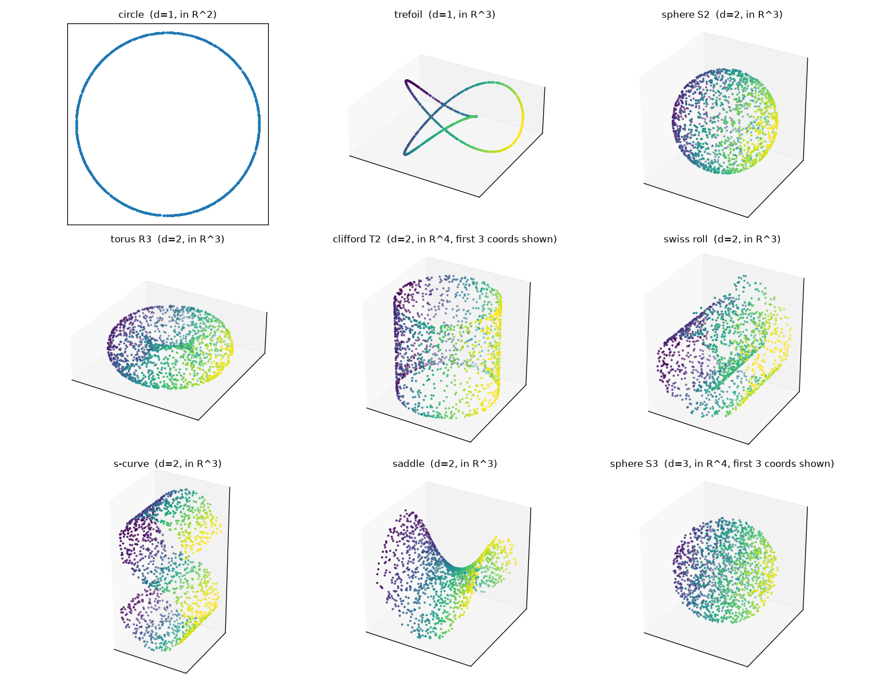

# Test manifolds

All manifolds are smooth embedded submanifolds with an **analytic tangent space**. Code: [tangent_est/manifolds.py](tangent_est/manifolds.py).
Figure: `results/manifolds.png`.

| name | intrinsic dim *d* | natural ambient dim *D* | parametrisation | sampling distribution | boundary |
|---|---|---|---|---|---|
| circle | 1 | 2 | (cos t, sin t) | t ~ U[0, 2π) | closed |
| trefoil | 1 | 3 | (sin t + 2 sin 2t, cos t − 2 cos 2t, −sin 3t) | t ~ U[0, 2π) (uniform in the parameter, not arclength) | closed |
| sphere S² | 2 | 3 | unit sphere | uniform on the sphere (normalised Gaussians) | closed |
| torus R³ | 2 | 3 | ((R + r cos v) cos u, (R + r cos v) sin u, r sin v), R=2, r=1 | uniform w.r.t. surface area (rejection sampling) | closed |
| Clifford torus T² | 2 | 4 | (cos u, sin u, cos v, sin v)/√2 | u, v ~ U[0, 2π) (flat torus, uniform) | closed |
| Swiss roll | 2 | 3 | (t cos t, h, t sin t) — `sklearn.datasets.make_swiss_roll` | t ~ U[1.5π, 4.5π], h ~ U[0, 21] (uniform in the parameters) | yes |
| S-curve | 2 | 3 | (sin t, h, sign(t)(cos t − 1)) — `sklearn.datasets.make_s_curve` | t ~ U[−1.5π, 1.5π], h ~ U[0, 2] | yes |
| saddle | 2 | 3 | (x, y, x² − y²) | (x, y) ~ U[−1, 1]² | yes |

**True tangent space.** Obtained from the Jacobian of the parametrisation (orthonormalised); for spheres from the projector I − xxᵀ.
It is the tangent space of the *clean* point, even when the observed point is noisy.

## Embedding into R^N

For a sample Y ∈ R^{n×D} of a manifold (rows are points) the data given to the methods is built as:

1. **Normalise:** subtract the mean and divide by the largest point norm, so that every manifold has maximum radius 1
   (an isotropic scaling and translation do not change tangent spaces).
2. **Isometric embedding R^D → R^N:** draw a Gaussian N×D matrix (fixed by the seed) and take its QR factor E, whose
   columns are orthonormal. The clean data is X₀ = Y Eᵀ and the true tangent basis is E·T (T = tangent basis in R^D).
   The manifold therefore lives in a random D-dimensional subspace of R^N; the remaining N − D ambient directions are empty.
3. **Noise:** i.i.d. Gaussian N(0, σ²) added to **every one of the N coordinates** (isotropic ambient noise). With N = 20 the noise
   vector has norm ≈ σ√N, e.g. ≈ 0.09 at σ = 0.02 and 0.22 at σ = 0.05, against a manifold of radius 1.
   (`noise="normal"` — noise only orthogonal to the tangent space, as in LEGO's tubular model — also exists and was used in the earlier numpy Exp B.)

Default experiment: n = 2000 points, N = 20, σ ∈ {0, 0.005, 0.01, 0.02, 0.03, 0.05}, several seeds (the seed changes both the sample and the embedding).
