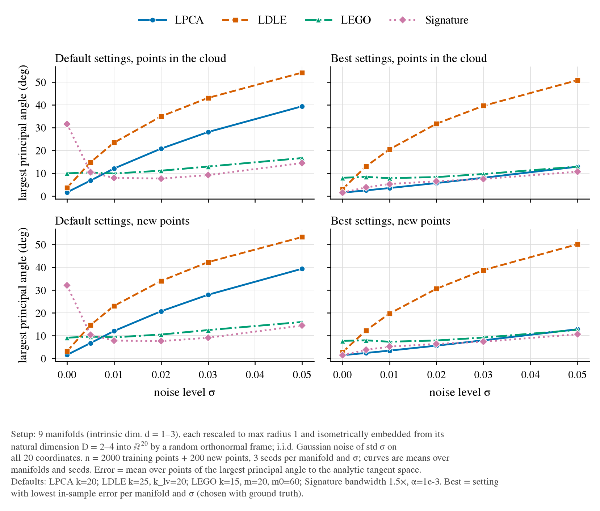
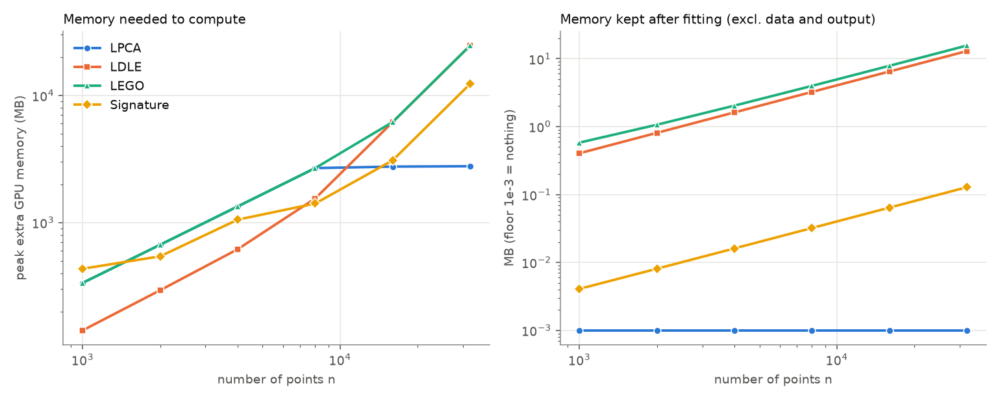
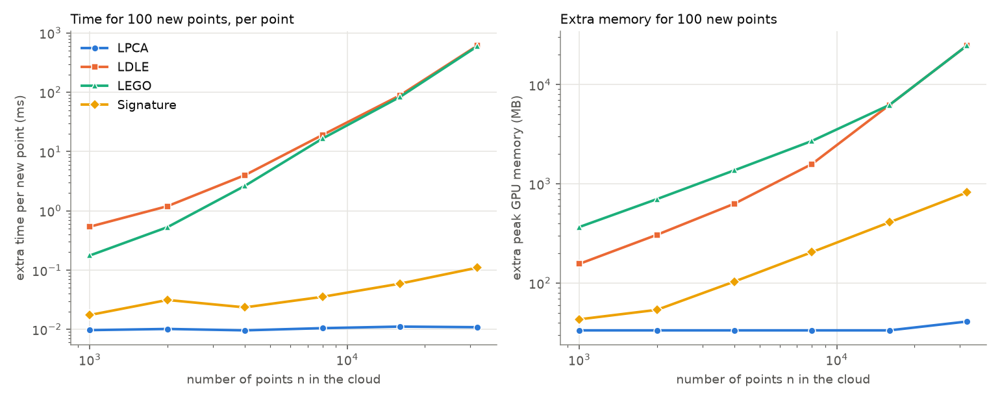

# LPCA vs LDLE vs LEGO vs Signature: tangent-space estimation on the GPU

Hardware: one NVIDIA A40 (mauao), PyTorch, **fp32**. Code: `tangent_torch/`, `bench_torch.py`, `analyze_torch.py`. Raw numbers: `results/torch_*.csv`; all tables: `results/torch_summary.md`.

## 1. Manifolds
See [MANIFOLDS.md](MANIFOLDS.md): 9 manifolds (circle, trefoil → d=1; sphere S², torus, Clifford torus, Swiss roll, S-curve, saddle → d=2; sphere S³ → d=3), each rescaled to max radius 1, isometrically embedded in R^20 by a random orthonormal frame, with i.i.d. Gaussian noise of std σ on all 20 coordinates. The true tangent space is the analytic one at the clean point.

Error metric everywhere: **mean over points of the largest principal angle** between estimated and true tangent space (degrees; lower is better).

## 2. Accuracy vs noise

Per manifold (default settings): `results/fig_noise_per_manifold.png`.

Setup: n = 2000 training points, N = 20, 3 seeds per manifold and noise level. "Default" = one fixed setting per method (LPCA k=20; LDLE k=25, klv=20; LEGO k=15, m=20, m0=60; Signature bandwidth 1.5×, α=1e-3). "Best" = the setting with the lowest in-sample error per manifold and noise level (chosen with the ground truth, so optimistic; the new-point error is reported for the setting chosen on the in-sample error, not tuned on the new points).

| noise σ | LPCA | LDLE | LEGO | Signature |
|---|---|---|---|---|
| **default settings, points in the cloud** | | | | |
| 0 | 1.6° | 3.6° | 9.9° | 31.6° |
| 0.01 | 12.0° | 23.4° | 9.8° | 7.9° |
| 0.02 | 20.7° | 34.9° | 11.1° | 7.6° |
| 0.05 | 39.3° | 54.1° | 16.6° | 14.4° |
| **best settings, points in the cloud** | | | | |
| 0 | 1.4° | 2.9° | 8.0° | 1.4° |
| 0.01 | 3.5° | 20.4° | 7.8° | 5.2° |
| 0.02 | 5.6° | 31.7° | 8.3° | 6.4° |
| 0.05 | 12.8° | 50.8° | 12.9° | 10.6° |

- With default settings LEGO and the signature method are far more robust to noise than LPCA and LDLE. LPCA's error grows roughly linearly with noise.
- With the best setting per case LPCA is hard to beat (best or tied for best at σ ≤ 0.02; the signature method is slightly ahead at σ ≥ 0.03); LEGO has a floor of ≈ 8° from its smoothing. LDLE is the weakest at every noise level.
- The signature's default (α=1e-3) is too strong a regulariser for clean data (31.6° at σ=0). It needs α matched to the noise.
- Per manifold, the elongated Swiss roll and S-curve are the hardest for every method.
- 7 of 5670 runs failed (all signature, α=1e-6: the fp32 Cholesky factorisation is not positive definite). They are left out.

## 3. Time vs sample size

Total time to get tangent spaces at all n points (kNN included), default settings, average of the sphere S² and Swiss roll at σ=0.02, N=20:

| n | LPCA | LDLE | LEGO | Signature |
|---|---|---|---|---|
| 1,000 | 0.004 s | 0.05 s | 0.017 s | 0.01 s |
| 4,000 | 0.008 s | 0.38 s | 0.25 s | 0.06 s |
| 16,000 | 0.05 s | 8.7 s | 8.2 s | 0.9 s |
| 32,000 | 0.14 s | 59.8 s | 59.2 s | 4.8 s |

- LPCA is roughly linear in n. The signature method grows faster than linearly (about n^2.4 between 16,000 and 32,000: dense kernel, global sums) but stays small at these sizes.
- LDLE and LEGO are dominated by the Laplacian eigendecomposition, a **dense** `eigh` in my GPU implementation (cubic in n). That is 98% of their time at n=32,000. A sparse iterative eigensolver would change this, but I did not implement one.
- Accuracy at these default settings is in `results/torch_summary.md` ("Error in the cloud").

## 4. Memory

| n | peak extra GPU memory while computing | | | | kept after fitting (excl. data/output) | | | |
|---|---|---|---|---|---|---|---|---|
| | LPCA | LDLE | LEGO | Sig | LPCA | LDLE | LEGO | Sig |
| 4,000 | 1.3 GB | 0.6 GB | 1.3 GB | 1.1 GB | 0 | 1.6 MB | 2.0 MB | 0.016 MB |
| 16,000 | 2.8 GB | 6.2 GB | 6.2 GB | 3.1 GB | 0 | 6.5 MB | 7.8 MB | 0.064 MB |
| 32,000 | 2.8 GB | 24.6 GB | 24.6 GB | 12.3 GB | 0 | 12.9 MB | 15.6 MB | 0.13 MB |

The data itself is 2.6 MB and the output tangents 5.1 MB at n=32,000, for every method.

- **To compute:** LDLE and LEGO need a dense n×n matrix plus the eigensolver's copies (about 6 copies of n²×4 bytes), so memory grows as n² and is ≈ 25 GB at n=32,000. The signature method peaks at about three n×n matrices (distances, kernel and its Cholesky factor).
- **LPCA's numbers are an artefact of batching.** Its algorithm needs a few hundred bytes per point, but PyTorch's batched `eigh` allocates about 330 KB of workspace per 20×20 matrix, so the peak is set by my batch of 8,192 points (≈ 2.7 GB). The same workspace shows up in LEGO's numbers up to n=8,000. These are not intrinsic to the methods.
- **To store:** after fitting, LPCA keeps nothing. LDLE keeps its eigenvectors (n×100) and LEGO its eigenvectors and a small coefficient tensor (n×60 + small). The signature keeps one weight per point. None of that is usable for new points except the signature's (see section 5).

## 5. New points (not in the original cloud)

How new points are handled:
- **LPCA** and the **signature function** evaluate directly at any point.
- **LDLE and LEGO**, as published, give tangents only for the points of the cloud they are run on. For new points I append them to the cloud and rerun the method. (I did not add an out-of-sample extension; you told me not to.) The cost is therefore that of a full refit, and the new points' tangents are computed with the old cloud included.

Batch of 100 new points, extra time per new point (and extra peak GPU memory):

| n in cloud | LPCA | LDLE | LEGO | Signature |
|---|---|---|---|---|
| 1,000 | 0.010 ms (33 MB) | 0.54 ms (156 MB) | 0.18 ms (368 MB) | 0.018 ms (43 MB) |
| 4,000 | 0.010 ms (33 MB) | 4.0 ms (631 MB) | 2.6 ms (1.4 GB) | 0.024 ms (104 MB) |
| 16,000 | 0.011 ms (33 MB) | 89 ms (6.2 GB) | 83 ms (6.2 GB) | 0.059 ms (410 MB) |
| 32,000 | 0.011 ms (41 MB) | 615 ms (24.8 GB) | 599 ms (24.8 GB) | 0.11 ms (819 MB) |

- LPCA's cost per new point does not depend on n. The signature's grows roughly linearly with n (each query sums over all n points) but stays around 0.1 ms.
- LDLE and LEGO pay for a refit every time (≈ 60 s at n=32,000), whether the batch has 1 or 100 points. A single new point costs the same as the whole refit (`results/torch_summary.md`, "a single new point").
- **Extra memory to store per method for new points:** LPCA none; signature one weight per training point (0.13 MB at n=32,000) plus the data; LDLE and LEGO nothing beyond the data, because they refit.
- **Accuracy on new points** (200 new points, same noise): essentially equal to the accuracy in the cloud for every method (bottom row of the noise figure). For LDLE/LEGO the new points benefit slightly from being part of a cloud of n+200 points.

## Caveats
- fp32 on the GPU agrees with the earlier float64 CPU implementations to within 0.06° on average (checked on 5 manifolds).
- Timing/memory: one run per point on one GPU, averaged over the two manifolds (sphere S² and Swiss roll), σ=0.02, N=20, default settings only. Dense eigensolves cap LDLE/LEGO at n=32,000 on a 48 GB card.
- The memory figures are PyTorch's peak allocator values; see the note on LPCA above.
- LDLE here is my adaptation of its eigenvector-selection step for tangent spaces (the paper does not define a tangent-space output), so its numbers should not be read as a verdict on the LDLE paper.
